

<picture>
  <source media="(prefers-color-scheme: dark)" srcset="./assets/header-dark.svg">
  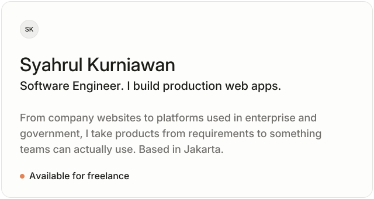
</picture>

<a href="https://yarul.dev">
<picture>
  <source media="(prefers-color-scheme: dark)" srcset="./assets/link-yarul-dark.svg">
  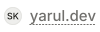
</picture>
</a>
<a href="mailto:syahrulkurniawan25@gmail.com">
<picture>
  <source media="(prefers-color-scheme: dark)" srcset="./assets/link-email-dark.svg">
  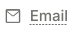
</picture>
</a>
<a href="https://www.linkedin.com/in/syahrul-kurniawan-1717a5193/">
<picture>
  <source media="(prefers-color-scheme: dark)" srcset="./assets/link-linkedin-dark.svg">
  
</picture>
</a>
<a href="https://twitter.com/syahrulkrn">
<picture>
  <source media="(prefers-color-scheme: dark)" srcset="./assets/link-x-dark.svg">
  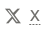
</picture>
</a>


<picture>
  <source media="(prefers-color-scheme: dark)" srcset="./assets/label-now-dark.svg">
  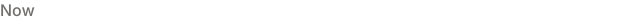
</picture>

<picture>
  <source media="(prefers-color-scheme: dark)" srcset="./assets/now-dark.svg">
  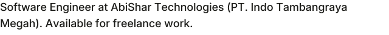
</picture>

<picture>
  <source media="(prefers-color-scheme: dark)" srcset="./assets/label-projects-dark.svg">
  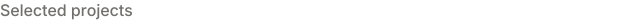
</picture>

<a href="https://yarul.dev/works/asna-academy">
<picture>
  <source media="(prefers-color-scheme: dark)" srcset="./assets/project-asna-academy-dark.svg">
  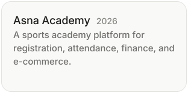
</picture>
</a>
<a href="https://yarul.dev/works/posind">
<picture>
  <source media="(prefers-color-scheme: dark)" srcset="./assets/project-pos-glid-dark.svg">
  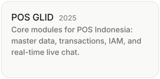
</picture>
</a>

<a href="https://yarul.dev/works/omahsabin">
<picture>
  <source media="(prefers-color-scheme: dark)" srcset="./assets/project-omah-sabin-dark.svg">
  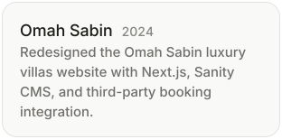
</picture>
</a>
<a href="https://yarul.dev/works/relocation-moving">
<picture>
  <source media="(prefers-color-scheme: dark)" srcset="./assets/project-relocation-moving-dark.svg">
  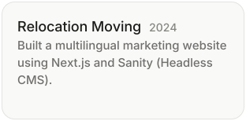
</picture>
</a>

<a href="https://yarul.dev">
<picture>
  <source media="(prefers-color-scheme: dark)" srcset="./assets/more-dark.svg">
  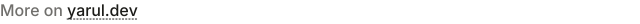
</picture>
</a>

<picture>
  <source media="(prefers-color-scheme: dark)" srcset="./assets/label-stack-dark.svg">
  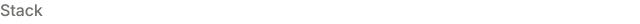
</picture>

<picture>
  <source media="(prefers-color-scheme: dark)" srcset="./assets/stack-dark.svg">
  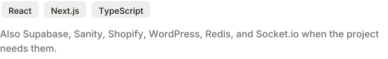
</picture>

<picture>
  <source media="(prefers-color-scheme: dark)" srcset="./assets/label-notes-dark.svg">
  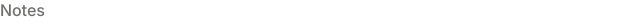
</picture>

<a href="https://yarul.dev/notes/setup-react-guide-beginners">
<picture>
  <source media="(prefers-color-scheme: dark)" srcset="./assets/note-setup-react-dark.svg">
  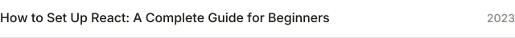
</picture>
</a>
<a href="https://yarul.dev/notes/learned-typescript-last-night">
<picture>
  <source media="(prefers-color-scheme: dark)" srcset="./assets/note-typescript-beginners-dark.svg">
  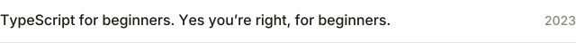
</picture>
</a>
<a href="https://yarul.dev/notes/the-most-progressive-student-binar">
<picture>
  <source media="(prefers-color-scheme: dark)" srcset="./assets/note-binar-dark.svg">
  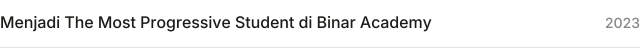
</picture>
</a>

